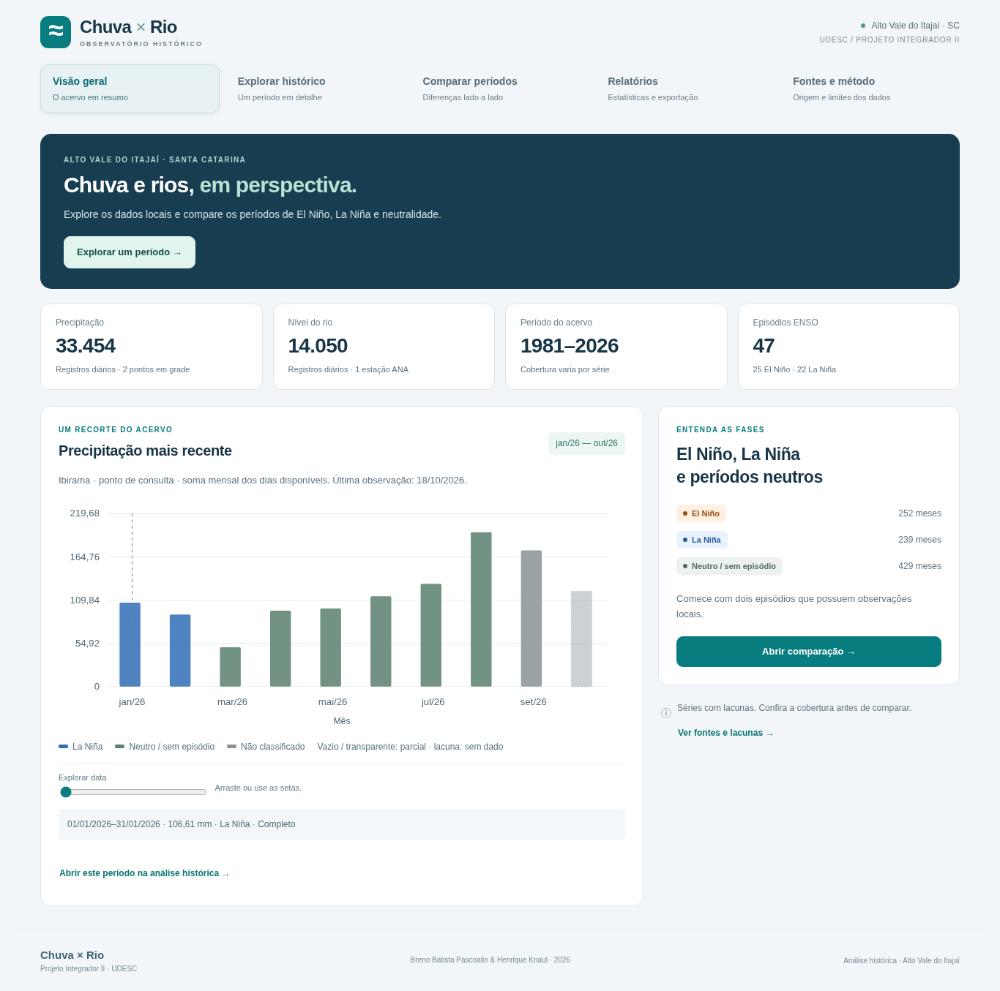

# Chuva × Rio

Análise histórica de precipitação, nível dos rios e fenômenos El Niño e La Niña no Alto Vale do Itajaí, Santa Catarina.
**Projeto Integrador II — UDESC CEAVI · Breno Batista Pascoalin e Henrique Knaul.**

A versão de apresentação tem cinco áreas de navegação, filtros ENSO, gráficos interativos, comparação e relatórios com CSV e PDF. O acervo inclui **47.504 medições de fontes oficiais** (33.454 registros de precipitação NASA POWER e 14.050 de nível da ANA), 920 índices RONI e 94 janelas NOAA/CPC. A ampliação manteve as 5.852 datas por estação da versão anterior. A revisão oficial da NASA corrigiu 572 valores de 2026 e os originais continuam arquivados.



## Executar em outra máquina

Requisito: **Python 3.11 ou superior**, com pip. Extraia o ZIP de entrega ou clone a branch de finalização e abra o terminal na pasta que contém `run.py`.

**Windows / PowerShell:**

```powershell
py -3 -m venv .venv
.\.venv\Scripts\python.exe -m pip install -r requirements.txt
.\.venv\Scripts\python.exe run.py
```

Se `py` não existir, use `python` na primeira linha. Não é necessário ativar scripts do PowerShell. Após instalar as dependências, as próximas aberturas também podem ser feitas com dois cliques em **`iniciar.cmd`**.

**Linux / macOS:**

```sh
python3 -m venv .venv
.venv/bin/python -m pip install -r requirements.txt
.venv/bin/python run.py
```

O iniciador carrega a demonstração quando o banco está vazio e abre **http://127.0.0.1:8000/**. Mantenha o terminal aberto; `Ctrl+C` encerra. Após a instalação, a consulta funciona sem internet: scripts, estilos e gráficos não dependem de CDN.

Não abra `static/index.html` diretamente: a interface precisa do servidor Python. A abertura como arquivo mostra instruções para iniciar corretamente. O GitHub hospeda o código; esta aplicação Python não é executada pelo GitHub Pages.

Nos exemplos seguintes, `python` representa o executável do ambiente virtual. Use `python run.py --no-browser` para não abrir uma aba automaticamente ou `python run.py --port 8001` se a porta padrão estiver ocupada.

## O que apresentar

| Área | Funcionalidades |
| --- | --- |
| **Visão Geral** | Indicadores de dados e cobertura, resumo gráfico e atalhos para explorar a base. |
| **Explorar histórico** | Escolha primeiro o período e os dados; ponto, estação e resolução ficam em “Local e detalhamento”. Valores, cobertura e máximos observados no intervalo. |
| **Comparar períodos** | Até três episódios, anos, datas personalizadas ou o período atual. Duração comum opcional e último dia com observação explícito. |
| **Relatórios** | Recorte por datas, local, variável, fase e resolução. Estatísticas, cobertura, gráficos, CSV dos pontos e PDF consolidado. |
| **Fontes e método** | Fontes oficiais, linha do tempo ENSO, critérios de agregação, cobertura por estação e histórico de cargas. |

Gráficos respondem às seleções; os valores podem ser consultados nos pontos, nas tabelas e no CSV. Chuva e nível têm painéis e unidades distintos. El Niño aparece em laranja, La Niña em azul e neutralidade em verde; meses sem classificação ficam em cinza. Detalhes de amostra, máximos e procedência podem ser expandidos. Veja o [roteiro de apresentação](docs/DEMONSTRACAO.md) e os [resultados de validação](docs/STATUS_MVP.md).

Em **Relatórios**, clique em **Salvar PDF** e escolha **Salvar como PDF** na caixa de impressão do navegador. O PDF reúne recorte, fontes, estatísticas e gráficos. O CSV separado preserva a tabela completa, com lacunas em branco.

Para demonstrar **El Niño, La Niña e neutralidade no mesmo ano**, consulte **2016**, que tem precipitação e nível durante todo o ano. **1998** também atravessa as três fases, mas o nível possui lacunas. **2023–2024** mostra chuva real e explicita a indisponibilidade de nível no snapshot.

## Dados reais e critérios

- **NOAA/CPC — RONI ERSSTv6:** classificação oficial com base de referência 1991–2020. A tabela considera ±0,5 °C sustentados por pelo menos cinco temporadas trimestrais sobrepostas. O sistema reproduz as marcações `roni-warm`, `roni-cold` e `roni-normal`; não deduz episódios de um valor isolado. [Fonte NOAA](https://www.cpc.ncep.noaa.gov/products/analysis_monitoring/enso/roni/).
- **Neutro / sem episódio confirmado:** corresponde à classe normal da tabela e pode incluir temporadas recentes ainda sem episódio confirmado. Um mês sem índice é **sem classificação**, nunca neutro por suposição. Os períodos usam os meses centrais das temporadas, não datas diárias de início físico do fenômeno.
- **NASA POWER — PRECTOTCORR:** precipitação diária em mm, nas coordenadas de Ibirama e Presidente Getúlio. É um produto em grade, não estação pluviométrica; pontos próximos podem compartilhar a mesma célula. [Documentação NASA](https://power.larc.nasa.gov/docs/services/api/temporal/daily/).
- **ANA/SNIRH — estação 83440000, Ibirama, Rio Itajaí do Norte/Hercílio:** médias diárias consistidas, com status real, convertidas de cm para m. Referencial altimétrico desconhecido; são cotas locais, não altitude absoluta. [HidroWeb](https://www.snirh.gov.br/hidroweb/).

O calendário distribuído cobre **janeiro de 1950 a agosto de 2026**. Há precipitação diária nos dois pontos de **01/01/1981 a 18/10/2026** e nível em Ibirama de **01/01/1981 a 31/12/2021**, com lacunas. Os pontos NASA retornaram os mesmos valores diários nesta base. A consulta de cotas de 2022 em diante não retornou médias diárias consistidas para incluir. Veja [cobertura, unidades e auditoria](data/README.md).

Chuva mensal é a **soma dos dias válidos**; nível mensal é a **média dos dias válidos**. Um total parcial não representa um mês completo. Os indicadores de comparação entre períodos usam médias diárias (mm/dia para chuva e m para nível), acompanhadas de amostra e cobertura, evitando comparar apenas totais de períodos com tamanhos diferentes.

O filtro ENSO conserva o eixo temporal: dias fora da fase escolhida são excluídos, sem serem contados como medições ausentes. Meses sem classificação são informados separadamente. Lacunas não são interpoladas nem convertidas em zero. A comparação de episódios por mês/dia relativo não controla sazonalidade; trecho comum limita a duração, mas não torna amostras equivalentes. Para múltiplos períodos mensais com trecho comum, inicie as janelas no dia 1; na resolução diária, podem começar em datas quaisquer.

**Limites de interpretação:** os gráficos são descritivos. Não comprovam causalidade, não fazem previsão nem emitem alertas. Máximos são os maiores valores disponíveis no recorte, não limiares de desastre. A cobertura varia por variável e o produto em grade tem resolução espacial limitada.

## Bancos existentes e atualização

Banco padrão: `data/chuva.sqlite`. A inicialização preserva medições e cargas existentes e migra o calendário antigo para contemplar as três classes, usando os índices já armazenados.

Para usar o acervo ampliado em uma instalação que já tem banco próprio, indique um caminho novo no PowerShell ou extraia o ZIP em outra pasta. A inicialização mantém o banco anterior e importa o snapshot atualizado somente no banco vazio.

```powershell
$env:CHUVA_DB="data/apresentacao.sqlite"
.\.venv\Scripts\python.exe run.py
```

`python -m app.cli demo` carrega manualmente o snapshot apenas em banco vazio; `python -m app.cli init` cria catálogo vazio. Não exclua o banco para atualizar a interface.

Atualizações das fontes exigem internet e são explícitas:

```sh
python -m app.cli noaa
python -m app.cli nasa --station power-ibirama --start 2023-01-01 --end 2024-03-31
python -m app.cli nasa --station power-presidente --start 2023-01-01 --end 2024-03-31
python -m app.cli ana --metadata data/ibirama-ana.json --start 2014-11-01 --end 2016-12-31
python -m app.cli backup --output data/backups/manual.sqlite
```

`python -m app.cli refresh` verifica a NOAA mensalmente e atualiza a NASA até ontem, revisitando até 30 dias para revisões. Também grava um backup com a data da execução. ANA permanece uma carga explícita. Não há agendamento instalado. Falhas de rede preservam o histórico, e a interface consulta apenas a API local. Arquivos brutos, hashes e registros de carga permitem conferir a procedência.

O importador alternativo `python -m app.cli river --file serie.csv --metadata estacao.json` recebe CSV UTF-8 `date,value`, com datas ISO e médias diárias documentadas. O JSON exige `code`, `name`, `latitude`, `longitude`, `reference` HTTPS, `unit` (`cm`/`m`), `statistic` (`daily_mean`) e `datum` conhecido ou `null`. Não aceita automaticamente todos os formatos HidroWeb nem calcula médias de leituras horárias. Datas duplicadas provocam rollback. Detalhes em [data/README.md](data/README.md).

## Testes

```sh
python -m unittest discover -s tests -v
node --check static/app.js
```

Os testes Python usam bancos temporários para classificação ENSO, migração, filtros, agregações, validação, lacunas, revisão, rollback e integridade. Teste de navegação opcional, com Node 20+:

```sh
npm install --no-save playwright
npx playwright install chromium firefox
node tests/browser.cjs
```

Deixe o Python do ambiente virtual no `PATH` ou defina `TEST_PYTHON` com seu caminho. `TEST_BROWSER` permite usar um executável Chromium/Edge instalado. O teste inicia uma instância temporária com banco descartável, interage com a aplicação e grava capturas em `output/screenshots`. Para Firefox, execute com `TEST_ENGINE=firefox`. Os testes usam bancos descartáveis. Os ensaios realizados estão em [docs/STATUS_MVP.md](docs/STATUS_MVP.md).

## Estrutura

- `app/`: FastAPI, SQLite, consultas e adaptadores NOAA/NASA/ANA.
- `static/`: HTML, CSS, JavaScript e gráficos SVG locais.
- `run.py` e `iniciar.cmd`: inicialização da base e servidor.
- `data/demo.json.gz` e `data/raw/`: snapshot real e arquivos de origem.
- `tests/`: testes de dados, API e navegação.
- `docs/`: especificação preservada, roteiro, validação e capturas.

Documentação interativa da API em **http://127.0.0.1:8000/docs**: `/api/catalog`, `/api/series`, `/api/compare`.

A [especificação acadêmica de 28/09](docs/Chuva_x_Rio_Especificacao_Revisada_28-09-2026.pdf) permanece como referência dos requisitos.

## Próxima etapa no Render

Após a entrega local, selecione a branch revisada em um Web Service Python. O ponto de entrada aceita endereço e porta, e faz a carga inicial apenas em banco vazio. O processo de hospedagem poderá instalar `requirements.txt` e executar `python run.py --no-browser --host 0.0.0.0 --port "$PORT"`. Após iniciar, valide a URL pública e os fluxos de consulta, comparação e exportação. [Web Services](https://render.com/docs/web-services).

Para uma demonstração com acervo fixo, o snapshot recria o SQLite quando o disco local é reiniciado. Se for necessário preservar cargas e backups entre reinícios, planeje armazenamento persistente e a posição de `CHUVA_DB`, arquivos brutos e backups antes da publicação. [Persistent Disks](https://render.com/docs/disks).
