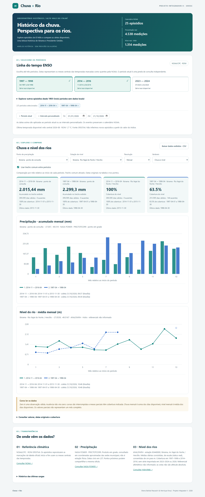

# Chuva × Rio

Análise histórica de chuva e nível dos rios no Alto Vale do Itajaí.
Projeto Integrador II — UDESC CEAVI. **Breno Batista Pascoalin e Henrique Knaul.**

MVP para **22/10/2026**: dashboard com calendário RONI/NOAA, precipitação NASA POWER e nível real da estação ANA **83440000 — Ibirama, Rio Itajaí do Norte/Hercílio**. Inclui comparação de até três períodos, gráficos diário/mensal, intervalo personalizado, origem, cobertura e exportação CSV. A base local contém **5.852 medições reais: 4.538 de chuva e 1.314 de nível**, além de 25 episódios ENSO.



## Executar no Windows

Python 3.11+ com pip. Na pasta do projeto, em PowerShell:

```powershell
py -3 -m venv .venv
.\.venv\Scripts\python.exe -m pip install -r requirements.txt
.\.venv\Scripts\python.exe run.py
```

O iniciador prepara a base de demonstração **somente se o banco estiver vazio**, inicia a aplicação completa e abre **http://127.0.0.1:8000/** no navegador. Bancos com cargas existentes são preservados. Mantenha o terminal aberto; Ctrl+C encerra. Depois da instalação, também é possível abrir `iniciar.cmd` na pasta do projeto.

**Não abra `static/index.html` diretamente como arquivo.** A interface precisa da API Python para consultar os dados. A abertura por `file://` agora exibe uma orientação para o iniciador, com CSS local; ela não simula o funcionamento da API. O código no GitHub também não significa que o servidor Python esteja hospedado em GitHub Pages.

Não é preciso ativar scripts PowerShell. Se não houver `py`, use `python` no primeiro comando. Após instalar as dependências e carregar a base, a consulta funciona sem internet. Para iniciar sem abrir uma aba automaticamente: `python run.py --no-browser`; para outra porta: `python run.py --port 8001`.

Linux/macOS:

```sh
python3 -m venv .venv
.venv/bin/python -m pip install -r requirements.txt
.venv/bin/python run.py
```

Nos exemplos seguintes, `python` significa o executável do ambiente virtual.
Banco padrão: `data/chuva.sqlite`. Para outro banco, defina `CHUVA_DB`.
No PowerShell: `$env:CHUVA_DB="data/outro.sqlite"`.
`python -m app.cli init` inicia catálogo vazio, sem o snapshot. Para carregar manualmente o snapshot em banco vazio, use `python -m app.cli demo`; o comando recusa bancos já carregados.

Se estiver retomando um banco da versão anterior e quiser conferir o novo snapshot sem alterar seu histórico, escolha um novo caminho, por exemplo `$env:CHUVA_DB="data/demonstracao-22-10.sqlite"`, e execute `run.py`.

## Demonstração e cobertura

Veja [roteiro de 5–7 minutos](docs/DEMONSTRACAO.md), [base e procedência](data/README.md) e [testes e pendências](docs/STATUS_MVP.md).

Compare a chuva de 2014–2016 com 2023–2024; para comparar chuva e nível reais juntos, escolha 1997–1998 e 2014–2016. Troque resolução e ponto municipal, consulte um intervalo personalizado, adicione o período atual e exporte CSV. Nível em 2023–2024 e no período atual permanece indisponível na base: a interface informa a lacuna.

A comparação usa dia/mês relativo, sem controlar sazonalidade. Meses completos mantêm seu número de dias; último mês parcial limita o corte. Para múltiplos períodos na resolução mensal com trecho comum, os inícios precisam ser no dia 1. A resolução diária aceita datas quaisquer. Não é análise causal ou previsão.

Chuva mensal é soma dos dias válidos; nível mensal é média dos dias válidos. Zero difere de ausência. Curvas não atravessam lacunas e pontos mensais parciais ficam isolados. RONI reproduz marcações da NOAA usando meses centrais das temporadas; não se classificam eventos por limiar próprio. Cotas de estações diferentes não são equiparadas.

## Atualizar dados

```sh
python -m app.cli noaa
python -m app.cli nasa --station power-ibirama --start 2023-01-01 --end 2024-03-31
python -m app.cli nasa --station power-presidente --start 2023-01-01 --end 2024-03-31
python -m app.cli ana --metadata data/ibirama-ana.json --start 2014-11-01 --end 2016-12-31
python -m app.cli refresh
python -m app.cli backup --output data/backups/manual.sqlite
```

`refresh` atualiza NOAA mensalmente e NASA até ontem, revisitando 30 dias para revisões.
Pode ser chamado pelo Agendador de Tarefas/cron; **nenhum agendamento foi instalado**.
Duas tentativas por requisição; falhas preservam histórico. `refresh` faz backup diário; cargas avulsas devem ser seguidas por `backup`. A atualização ANA é explícita pelo comando `ana`; não faz parte do `refresh`. A interface não consulta APIs externas.

## Importar nível de rio

A estação Ibirama já está cadastrada em [`data/ibirama-ana.json`](data/ibirama-ana.json), com inventário, referências e hash. O adaptador `ana` lê XML do serviço público ANA/SNIRH ou um XML salvo por meio de `--file`. Seleciona registros consistidos (`NivelConsistencia=2`), média diária (`MediaDiaria=1`) e valores diários reais (`status=1`), convertendo centímetros para metros. Campos ausentes não se tornam zero. O referencial altimétrico não está informado; a cota não representa altitude absoluta.

Também permanece disponível o importador genérico de CSV intermediário UTF-8 com cabeçalho `date,value`, data ISO e **média diária documentada**. Ele não aceita todos os layouts HidroWeb nem calcula médias de leituras horárias. Datas repetidas no mesmo CSV provocam rollback.

Prepare também um JSON com:
`code`, `name`, `latitude`, `longitude`, `reference` (HTTPS do arquivo público),
`unit` (`cm` ou `m`), `statistic` (`daily_mean`) e `datum` (texto ou null se desconhecido).
Use código e coordenadas reais. Conserve o arquivo original e descreva a transformação;
campos adicionais no JSON ficam preservados na auditoria.

```sh
python -m app.cli river --file caminho/serie.csv --metadata caminho/estacao.json
```

Recarregue a página para selecionar a estação. Não use amostras dos testes como observações.

## Testes

```sh
python -m unittest discover -s tests -v
node --check static/app.js
```

Testes em bancos temporários: API, calendário, lacunas, unidades, agregação, revisão,
falha de rede, rollback e backup. Teste opcional de navegador (Node 20+):

```sh
npm install --no-save playwright
npx playwright install chromium
node tests/browser.cjs
```

Use Python do ambiente virtual no PATH ou defina `TEST_PYTHON`.
`TEST_BROWSER` permite indicar Chromium instalado. O teste de navegação usa `run.py` com banco novo, verifica o carregamento inicial e o reinício sem duplicar dados, além das interações no dashboard. As capturas ficam em `output/screenshots`; consulte o script para a porta usada. Os resultados da rodada final estão em `docs/STATUS_MVP.md`.

## Estrutura

- `app/db.py`: SQLite, catálogo, integridade e persistência.
- `app/ingest.py`: adaptadores NOAA/NASA/ANA/CSV, normalização, artefatos e auditoria.
- `run.py` e `iniciar.cmd`: inicialização da base, servidor e navegador.
- `app/series.py`: cobertura, agregação e alinhamento.
- `app/main.py`: FastAPI de consulta e arquivos estáticos.
- `app/cli.py`: cargas, atualização e backup.
- `static/`: HTML/CSS/JavaScript, SVG local sem CDN.
- `data/demo.json`: snapshot real para demonstração offline.
- `data/raw/`: artefatos originais das cargas.
- `tests/`: dados/API e navegador.

API em `/docs`: `/api/catalog`, `/api/series`, `/api/compare`.
Aplicação local, sem autenticação nem endpoints públicos de escrita.
SQLite simplifica a demonstração; migração PostgreSQL e homologação de produção ficam pendentes.

A [especificação original](docs/Chuva_x_Rio_Especificacao_Revisada_28-09-2026.pdf) foi preservada.
O repositório base (`dbcaba4`) continha apenas README e PDF, sem implementação.
A implementação anterior no commit `e066dcf` foi preservada e evoluída nesta revisão. A entrega segue Python/FastAPI propostos no PDF, substituindo a intenção Java do README original.
